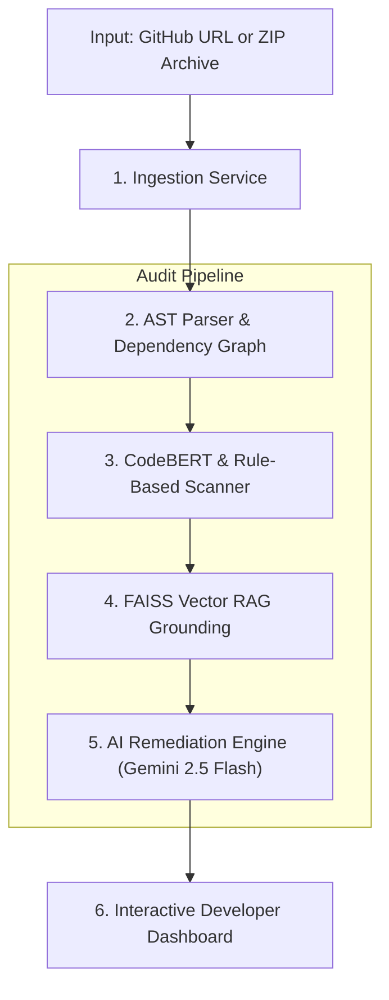

# Codebase Architecture & Risk Auditor 🛡️🔍

> **An AI-powered cybersecurity platform that automatically scans software repositories, pinpoints security vulnerabilities, maps code architecture, and generates verified, side-by-side replacement patches.**

[](https://www.python.org/)
[](https://fastapi.tiangolo.com/)
[](https://react.dev/)
[-F0AD4E?logo=huggingface&logoColor=black)](https://huggingface.co/microsoft/codebert-base)
[](https://github.com/facebookresearch/faiss)
[](https://github.com/langchain-ai/langgraph)
[](https://ai.google.dev/)
[](LICENSE)

---

## 📖 Table of Contents
- [About the Project](#-about-the-project)
- [Why Traditional Tools Fall Short](#-why-traditional-tools-fall-short)
- [Key Features](#-key-features)
- [How It Works (System Architecture)](#-how-it-works-system-architecture)
- [Vulnerabilities Detected](#-vulnerabilities-detected)
- [Tech Stack](#-tech-stack)
- [Quickstart Installation Guide](#-quickstart-installation-guide)
  - [Prerequisites](#prerequisites)
  - [1. Clone Repository](#1-clone-repository)
  - [2. Configure Environment (`.env`)](#2-configure-environment-env)
  - [3. Backend Setup](#3-backend-setup)
  - [4. Frontend Setup](#4-frontend-setup)
  - [5. Run the Application](#5-run-the-application)
- [Project Directory Layout](#-project-directory-layout)
- [Project Documentation Hub](#-project-documentation-hub)
- [Academic Context & License](#-academic-context--license)

---

## 💡 About the Project

When developers write code, security vulnerabilities often slip in unnoticed—such as raw database queries vulnerable to SQL injection, unvalidated system commands, exposed API keys, or cross-site scripting risks.

**Codebase Architecture & Risk Auditor** is a static application security testing (SAST) platform. It allows anyone to provide a **GitHub Repository URL** or upload a **ZIP code archive**. The platform then performs an end-to-end security audit:

1. **Breaks down the codebase** into individual functions and classes using Abstract Syntax Trees (AST).
2. **Builds an interactive visual dependency graph** showing which files and functions call each other.
3. **Scans for security flaws** using fine-tuned deep learning (CodeBERT) and MITRE CWE rules.
4. **Verifies the findings** against an offline vector knowledge base (FAISS RAG) containing official MITRE CWE and OWASP Top 10 standards.
5. **Generates verified, side-by-side code fixes** with an interactive split diff viewer so developers can review and copy safe replacement code immediately.

---

## ⚖️ Why Traditional Tools Fall Short

| Challenge | Traditional Scanners (SonarQube / Snyk) | Pure AI Chatbots (ChatGPT / Copilot) | Our Platform |
|---|---|---|---|
| **False Positives** | High (triggers on rigid keywords without understanding context) | Moderate | **Low** (combines AST code parsing with deep learning) |
| **Fix Suggestions** | Tells you *what* is wrong, but rarely provides complete drop-in fixes | Often hallucinates invalid code, wrong line numbers, or fake CVEs | **Grounded & Verified** (grounded in official MITRE standards with verified fixes) |
| **Code Architecture** | Buried in long text logs | No visual dependency structure | **Interactive React Flow Graph** showing real call paths |
| **Fix Comparison** | Unified raw git patch text | Raw text blocks | **Side-by-Side Diff Viewer** with full wrapping and zero horizontal scrolling |

---

## ✨ Key Features

- 🔗 **Dual Ingestion Channels**:
  - **Public GitHub Repositories**: Directly clone and audit any public repo using shallow cloning for speed.
  - **ZIP Project Archives**: Drag-and-drop or browse project archives (`.zip`) with built-in path-traversal safeguards.

- 🕸️ **Interactive Code Call Graph**:
  - Automatically maps out function relationships, imports, and cross-file dependencies.
  - Rendered with an interactive **React Flow** canvas featuring zoom, pan, minimap, and file-level inspection.

- 🧠 **CodeBERT Deep Learning Detection**:
  - Powered by a 125-million-parameter CodeBERT neural model trained on the CodeXGLUE Devign dataset.
  - Understands code semantics beyond basic regex keyword matching.

- 📚 **Grounded Vector Knowledge (FAISS RAG)**:
  - Embeds official MITRE CWE and OWASP Top 10 documentation locally into 384-dimensional dense vectors using `all-MiniLM-L6-v2`.
  - Retrieves exact explanations, impact descriptions, and industry-standard mitigations for every detected flaw.

- ⚡ **Side-by-Side Diff & Fix Viewer**:
  - Compare the original vulnerable code directly against the secure replacement patch.
  - Strict 50%/50% split view with automatic line wrapping—no horizontal scrolling required.
  - One-click copy button to paste the secure replacement straight into your project.

- 🚨 **Laser Scan Progress Telemetry**:
  - Replaces boring progress bars with an animated cybersecurity radar and laser scanning animation.
  - Dynamically cycles through active audit stages with real-time percentage tracking.

---

## 🏛️ How It Works (System Architecture)

The system is coordinated by a state machine powered by **LangGraph**:



### The 5 Pipeline Stages:
1. **Ingestion**: Safely extracts the uploaded ZIP file or performs a shallow clone of the GitHub repository.
2. **AST & Call Graph**: Uses native syntax tree parsers to break files into discrete function chunks (`file.py:L10-L25`) and builds a directed call graph of dependencies using NetworkX.
3. **Vulnerability Detection**: Runs function chunks through the CodeBERT classifier and MITRE vulnerability rule-matchers.
4. **FAISS Vector Grounding**: Queries the local vector database to attach authoritative CWE citations, descriptions, and mitigation strategies.
5. **AI Remediation & Patching**: Generates production-grade replacement patches using Google Gemini with an offline fallback generator to ensure zero downtime.

---

## 🛡️ Vulnerabilities Detected

The platform focuses on critical security risks defined by the **MITRE CWE Top 25** and **OWASP Top 10**:

| Vulnerability Category | MITRE CWE ID | OWASP Category | Example Risk |
|---|---|---|---|
| **SQL Injection** | `CWE-89` | A03:2021 – Injection | Unescaped string concatenation in database queries |
| **OS Command Injection** | `CWE-78` | A03:2021 – Injection | Passing unsanitized input to `os.system` or shell subprocesses |
| **Cross-Site Scripting (XSS)** | `CWE-79` | A03:2021 – Injection | Injecting untrusted data into `innerHTML` or browser DOM |
| **Hardcoded Secrets & API Keys** | `CWE-798` | A07:2021 – Auth Failures | Exposing Stripe keys, AWS tokens, or private credentials in code |
| **Path Traversal** | `CWE-22` | A01:2021 – Broken Access | Using unvalidated relative paths (`../`) to access restricted files |
| **Insecure Deserialization** | `CWE-502` | A08:2021 – Integrity Failures | Deserializing untrusted objects with `pickle.loads` |
| **Weak Cryptography** | `CWE-328` | A02:2021 – Crypto Failures | Using broken hashing algorithms like MD5 or SHA-1 for passwords |
| **Server-Side Request Forgery** | `CWE-918` | A10:2021 – SSRF | Fetching arbitrary internal URLs without IP allowlisting |
| **Arbitrary File Upload** | `CWE-434` | A08:2021 – Integrity Failures | Uploading unverified executables or scripts to web roots |
| **Code Injection** | `CWE-94` | A03:2021 – Injection | Dynamic evaluation of untrusted strings via `eval()` or `exec()` |
| **Buffer Overflow** | `CWE-787` | Memory Safety | Using unbounded memory copy functions (`strcpy`) in C/C++ |

---

## 💻 Tech Stack

- **Backend**: Python 3.10+, FastAPI, Uvicorn, Pydantic
- **Frontend**: React 18, Vite, Tailwind CSS, Lucide Icons, React Flow (`@xyflow/react`)
- **AI & Deep Learning**: CodeBERT (Hugging Face Transformers), PyTorch, Google Gemini 2.5 Flash
- **Vector Search & RAG**: Meta FAISS (`faiss-cpu`), `sentence-transformers` (`all-MiniLM-L6-v2`)
- **Agent Workflow**: LangGraph, NetworkX (graph topology)

---

## 🚀 Quickstart Installation Guide

### Prerequisites
- **Python**: Version 3.10 or 3.11 installed
- **Node.js**: Version 18 or higher with `npm`
- **Git**: Installed and accessible in your terminal

---

### 1. Clone Repository
```bash
git clone https://github.com/Chetan-2715/7th-Sem-Project-.git
cd 7th-Sem-Project-
```

---

### 2. Configure Environment (`.env`)
Create your `.env` configuration file from the template:
```bash
cp .env.example .env
```
Open `.env` in any text editor and add your Google Gemini API key:
```env
GEMINI_API_KEY="your-gemini-api-key-here"
```
> [!NOTE]
> You can get a free Gemini API key from [Google AI Studio](https://aistudio.google.com/). If no key is provided, the platform automatically uses its offline deterministic patch generator.

---

### 3. Backend Setup
Create and activate a Python virtual environment:

**On Windows (PowerShell):**
```powershell
python -m venv venv
.\venv\Scripts\activate
pip install --upgrade pip
pip install -r requirements.txt
```

**On Linux / macOS:**
```bash
python3 -m venv venv
source venv/bin/activate
pip install --upgrade pip
pip install -r requirements.txt
```

---

### 4. Frontend Setup
In a new terminal, install the frontend dependencies:
```bash
cd frontend
npm install
cd ..
```

---

### 5. Run the Application

#### Step A: Start the FastAPI Backend
```powershell
.\venv\Scripts\python -m uvicorn backend.main:app --host 0.0.0.0 --port 8000 --reload
```
- API is live at: `http://localhost:8000`
- Interactive API Docs (Swagger): `http://localhost:8000/docs`

#### Step B: Start the React Frontend
In a separate terminal window:
```powershell
cd frontend
npm run dev
```
- Open your browser and navigate to: **`http://localhost:5173`**

---

## 📂 Project Directory Layout

```text
7th-Sem-Project-/
├── backend/                       # FastAPI REST Backend
│   ├── main.py                    # Server entrypoint and CORS setup
│   ├── schemas.py                 # Request and response data models
│   ├── routers/                   # API routes (/api/audit, /api/audit-upload)
│   ├── services/                  # Ingestion service and task manager
│   └── tests/                     # Backend unit and end-to-end test suite
│
├── frontend/                      # React 18 + Vite Web Application
│   ├── src/
│   │   ├── App.jsx                # Main application page
│   │   ├── components/            # UI Components (DiffViewer, CallGraph, etc.)
│   │   │   ├── AuditInput.jsx     # Dual-tab input (Git repo & ZIP upload)
│   │   │   ├── DiffViewer.jsx     # 50/50 split diff viewer with auto-wrapping
│   │   │   ├── DependencyFlow.jsx # React Flow interactive call graph
│   │   │   ├── ProgressBar.jsx    # Laser scan audit progress loader
│   │   │   ├── FindingsTable.jsx  # Vulnerability findings table with filters
│   │   │   └── HealthScoreGauge.jsx # Circular security score gauge
│   │   └── index.css              # Custom styling, themes, and animations
│   └── package.json
│
├── agent/                         # LangGraph Multi-Agent Security Pipeline
│   ├── orchestrator.py            # Workflow StateGraph DAG coordinator
│   ├── nodes.py                   # Scanning, FAISS grounding, and fix generation
│   ├── llm_engine.py              # Gemini 2.5 Flash integration with fallback
│   └── state.py                   # Agent state definition
│
├── ml_pipeline/                   # Deep Learning Vulnerability Classifier
│   ├── model.py                   # CodeBERT sequence classification wrapper
│   ├── inference.py               # Standalone code snippet prediction script
│   └── train.py                   # PyTorch training script on Devign dataset
│
├── parser_engine/                 # AST Code Parsing & Graph Builder
│   ├── ast_slicer.py              # Function extraction with line boundaries
│   └── graph_builder.py           # NetworkX dependency graph constructor
│
├── rag_engine/                    # Vector Knowledge Base
│   ├── vector_store.py            # Local FAISS index and MiniLM embeddings
│   └── corpus/                    # MITRE CWE and OWASP standards dataset
│
├── docs/                          # Comprehensive Documentation Hub
├── .env.example                   # Environment variable template
├── requirements.txt               # Python package dependencies
└── README.md                      # Project documentation (this file)
```

---

## 📚 Project Documentation Hub

Detailed technical documentation and university submission materials are located in the [`docs/`](docs/) directory:

- 📖 [**Architecture Specification**](docs/Architecture.md): Complete system architecture, data models, and API specifications.
- 🎨 [**UI/UX Design Guidelines**](docs/Design.md): Visual design tokens, color system, and layout principles.
- 📋 [**Product Requirements Document (PRD)**](docs/PRD.md): Product vision, requirements, and user stories.
- 🗺️ [**Build Roadmap & Phases**](docs/Phases.md): Milestone tracker covering Phase 0 through Phase 8.
- 🎓 [**Academic Project Synopsis**](docs/Project_Synopsis_Review_1_Official.md): Official Review-1 synopsis document.
- 👥 [**Team Viva & Report Guide**](docs/TEAM_GUIDE_AND_REPORT_PROMPT.md): University viva preparation guide and thesis prompts.

---

## 🎓 Academic Context & License

This project was developed for the **7th Semester Major Project (Academic Year 2026–2027)** as part of the undergraduate curriculum.

Released under the open-source [MIT License](LICENSE).
