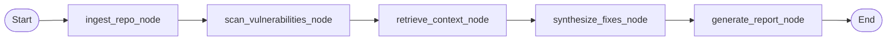

# Architecture.md — System Architecture & Component Specification

## High-Level System Workflow

```
[ Multi-Modal Input: GitHub URL | ZIP Archive | Single File | Raw Code Snippet ]
                                        │
                                        ▼
┌───────────────────────────────────────────────────────────────────────────────┐
│ 1. INGESTION & LANGUAGE RECOGNITION (backend/services/ingestor.py)            │
│   • Shallow Git Clone (--depth 1) or ZIP extraction with path safety          │
│   • Single-file and raw code in-memory ingestion                              │
│   • Heuristic Language Detection (Python, JS, TS, Java, C, C++, PHP, SQL, Go)│
│   • UTF-8 BOM (\ufeff) Normalization & Multi-Line Sanitization                │
└───────────────────────────────────────┬───────────────────────────────────────┘
                                        │
                                        ▼
┌───────────────────────────────────────────────────────────────────────────────┐
│ 2. PARSING & DEPENDENCY GRAPH ENGINE (parser_engine/ & agent/nodes.py)        │
│   • AST Slicing: Functions, signatures, and exact line ranges (file.py:L42-58)│
│   • NetworkX DiGraph: Cross-file module import and invocation topology        │
│   • Polyglot Syntax Engine: Python AST, Node vm.Script, delimiter balancing   │
│   • Maps broken syntax, unclosed braces, and missing semicolons to CWE-754    │
└───────────────────────────────────────┬───────────────────────────────────────┘
                                        │
                                        ▼
┌───────────────────────────────────────────────────────────────────────────────┐
│ 3. NEURAL & SYMBOLIC CLASSIFIER (ml_pipeline/ & agent/nodes.py)               │
│   • Fine-Tuned CodeBERT (125M parameters) trained on CodeXGLUE Devign dataset │
│   • Evaluates 18 MITRE CWE Top 25 & OWASP vulnerability categories             │
│   • Outputs confidence scores (0.0 to 1.0) and vulnerability classifications  │
└───────────────────────────────────────┬───────────────────────────────────────┘
                                        │
                                        ▼
┌───────────────────────────────────────────────────────────────────────────────┐
│ 4. DENSE VECTOR RAG RETRIEVAL (rag_engine/vector_store.py)                    │
│   • sentence-transformers (all-MiniLM-L6-v2) generates 384-d dense vectors    │
│   • Local FAISS index searches official MITRE CWE & OWASP documentation       │
│   • Sub-millisecond top-k retrieval of grounded descriptions & mitigations    │
└───────────────────────────────────────┬───────────────────────────────────────┘
                                        │
                                        ▼
┌───────────────────────────────────────────────────────────────────────────────┐
│ 5. PARALLELIZED LANGGRAPH AGENT (agent/orchestrator.py & agent/nodes.py)      │
│   • StateGraph DAG: Ingest ──► Scan ──► Retrieve ──► Synthesize ──► Report    │
│   • Concurrent Fix Synthesis via ThreadPoolExecutor(max_workers=5)            │
│   • Google Gemini 2.5 Flash API with signature deduplication caching          │
│   • Offline deterministic fallback synthesizer for zero-downtime reliability  │
│   • Comment protection preventing comment lines from being corrupted          │
└───────────────────────────────────────┬───────────────────────────────────────┘
                                        │
                                        ▼
┌───────────────────────────────────────────────────────────────────────────────┐
│ 6. FASTAPI ASYNC BACKEND (backend/main.py & backend/routers/audit.py)         │
│   • Background task execution with thread-safe TaskManager                    │
│   • Pydantic schema validation (AuditRequest, AuditResult, Finding)           │
│   • REST polling & real-time progress updates                                 │
└───────────────────────────────────────┬───────────────────────────────────────┘
                                        │
                                        ▼
┌───────────────────────────────────────────────────────────────────────────────┐
│ 7. REACT AUDIT DASHBOARD (frontend/src/)                                      │
│   • 4 Ingestion Tabs: GitHub Repo, ZIP File, Single File, Raw Code            │
│   • Real-Time Auto-Detected Language Indicator Badge                          │
│   • Security Health Score Gauge (0–100)                                       │
│   • Filterable findings table with severity badges (Critical, High, Med, Low) │
│   • Side-by-side Monaco-style Diff Viewer highlighting replacement code       │
│   • React Flow interactive dependency call graph                              │
└───────────────────────────────────────────────────────────────────────────────┘
```

---

## Technical Stack Specification

| Layer | Component / Technology | Specification & Purpose |
|---|---|---|
| **Ingestion Engine** | GitPython, zipfile, `ingestor.py` | Shallow clone (`--depth 1`), safe ZIP extraction, single file, and raw code ingestion |
| **Language Detection** | Regular expressions & keyword scoring | Heuristic detection for Python, JS, TS, Java, C, C++, SQL, PHP, Go, Rust |
| **Parsing & AST** | Python `ast`, Node.js `vm`, Delimiter matchers | Line-level function boundaries, syntax validation (CWE-754) |
| **Architectural Graph** | NetworkX (`nx.DiGraph`) | Direct invocation mapping, node risk coloring, blast-radius tracking |
| **Deep Learning** | `microsoft/codebert-base` (125M params) | Sequence classification on CodeXGLUE Devign dataset |
| **Vector Embeddings** | `sentence-transformers/all-MiniLM-L6-v2` | 384-dimensional dense semantic representations |
| **Vector Index** | Meta FAISS (`IndexFlatL2`) | Offline local vector store over MITRE CWE Top 25 & OWASP |
| **Agentic Workflow** | LangGraph (`StateGraph`) | Stateful DAG workflow pipeline with deterministic node routing |
| **Generative LLM** | Google Gemini 2.5 Flash (`google-genai`) | Context-aware replacement code synthesis with ThreadPoolExecutor |
| **Backend API** | FastAPI + Uvicorn | High-throughput asynchronous REST API with Pydantic schemas |
| **Frontend UI** | React 18, Vite, Tailwind CSS, React Flow | Responsive dark-mode dashboard with interactive diffs and graphs |

---

## Multi-Agent State Machine (LangGraph DAG)

The agent operates as a finite state graph defined in `agent/orchestrator.py`:



1. **`ingest_repo_node`**: Fetches the codebase or snippet, builds the file tree, extracts functions, and maps dependencies using NetworkX.
2. **`scan_vulnerabilities_node`**: Analyzes all parsed functions against the 18 CWE categories and applies polyglot syntax validation.
3. **`retrieve_context_node`**: Executes FAISS vector queries for each flagged finding to retrieve verified CVE/CWE descriptions and mitigation guidelines.
4. **`synthesize_fixes_node`**: Dispatches parallel Gemini 2.5 Flash workers via a thread pool to generate side-by-side replacement code fixes with signature caching.
5. **`generate_report_node`**: Computes the repository Security Health Score, assigns risk levels, and structures the final audit report.

---

## Repository Directory Organization

```
D:\7th SEM MAJOR\
├── .env.example                       # Environment configuration template
├── .gitignore                          # Strict gitignore protecting keys, venvs, binaries
├── README.md                           # Master repository showcase and overview
├── requirements.txt                    # Root Python dependencies
│
├── docs/                               # Comprehensive project documentation
│   ├── Architecture.md                 # System architecture and data flow
│   ├── Design.md                       # UI/UX design specifications and color tokens
│   ├── PRD.md                          # Product Requirements Document
│   ├── Phases.md                       # Build roadmap and team execution plan
│   ├── Rules.md                        # AI developer rules and development boundaries
│   ├── Memory.md                       # Persistent progress log and decisions ledger
│   ├── instructions.md                 # Guidelines for AI assistants and contributors
│   ├── Project_Synopsis_Review_1_Official.md # Academic project synopsis
│   └── TEAM_GUIDE_AND_REPORT_PROMPT.md # Team guide and AI viva prompt
│
├── agent/                              # LangGraph Agentic Pipeline
│   ├── llm_engine.py                   # Google Gemini API connector with fallback
│   ├── nodes.py                        # Execution nodes (polyglot syntax, scanner, parallel fix)
│   ├── orchestrator.py                 # LangGraph StateGraph DAG definition
│   ├── state.py                        # TypedDict AgentState schema
│   └── tests/verify_agent.py           # Unit verification test suite
│
├── backend/                            # FastAPI REST Backend
│   ├── main.py                         # Application entrypoint & CORS configuration
│   ├── schemas.py                      # Pydantic data schemas (AuditRequest, Finding, etc.)
│   ├── routers/
│   │   └── audit.py                    # Multi-modal audit endpoints (/audit, /audit-raw, etc.)
│   ├── services/
│   │   ├── ingestor.py                 # Ingestion service (Git, ZIP, file, raw code)
│   │   └── task_manager.py             # Asynchronous thread-safe task manager
│   └── tests/
│       ├── test_backend.py             # Pytest endpoint validation
│       └── test_e2e_pipeline.py        # End-to-end integration tests
│
├── frontend/                           # React + Vite Developer Dashboard
│   ├── src/
│   │   ├── App.jsx                     # Core application view & audit state machine
│   │   ├── components/
│   │   │   ├── AuditInput.jsx          # 4-mode input component with auto-language badge
│   │   │   ├── HealthScoreGauge.jsx    # SVG circular health score gauge (0-100)
│   │   │   ├── MetricCards.jsx         # Summary cards (Total, Critical, High, Medium, Low)
│   │   │   ├── FindingsTable.jsx       # Interactive findings table with search & filters
│   │   │   ├── DiffViewer.jsx          # Side-by-side original vs fixed code diff viewer
│   │   │   ├── DependencyFlow.jsx      # React Flow interactive dependency call graph
│   │   │   ├── ProgressBar.jsx         # Multi-stage animated pipeline progress indicator
│   │   │   └── Header.jsx              # Navigation header with system health status
│   │   └── index.css                   # Tailwind CSS styling and theme definitions
│   ├── package.json
│   └── vite.config.js
│
├── ml_pipeline/                        # Deep Learning Classification Engine
│   ├── model.py                        # CodeBERT sequence classification wrapper
│   ├── dataset.py                      # PyTorch Dataset for CodeXGLUE Devign
│   ├── train.py                        # Model training script with mixed-precision fp16
│   ├── inference.py                    # Standalone snippet inference tester
│   └── download_dataset.py             # Automated Devign dataset fetcher
│
├── parser_engine/                      # Symbolic Code Parsing & Graph Engine
│   ├── ast_slicer.py                   # AST function extraction with line numbers (L42-L58)
│   ├── graph_builder.py                # NetworkX call graph constructor
│   └── tests/test_parser.py            # Unit test suite for AST and Graph engines
│
└── rag_engine/                         # Retrieval-Augmented Generation Layer
    ├── vector_store.py                 # FAISS local vector store with MiniLM embeddings
    ├── corpus/
    │   └── cwe_owasp_knowledge_base.json # Curated MITRE CWE Top 25 & OWASP knowledge base
    └── tests/verify_rag.py             # RAG retrieval accuracy test suite
```

---

## REST API Specification

### Ingestion & Audit Endpoints

| Method | Endpoint | Request Body / Form | Description |
|---|---|---|---|
| `POST` | `/api/audit` | `{"repo_url": "https://github.com/..."}` | Initiates asynchronous audit on a public GitHub repo |
| `POST` | `/api/audit-upload` | Multipart Form: `file` (ZIP) | Safely unpacks and audits uploaded ZIP archive |
| `POST` | `/api/audit-file` | Multipart Form: `file` (single file) | Audits a single uploaded source file |
| `POST` | `/api/audit-raw` | `{"code": "...", "language": "auto"}` | Audits raw code snippet with auto-detected language |
| `GET` | `/api/audit/{task_id}/status` | None | Returns real-time status and stage progress (`0-100%`) |
| `GET` | `/api/audit/{task_id}/report` | None | Returns the full structured `AuditResult` report |
| `GET` | `/api/health` | None | System health check and model availability status |
| `GET` | `/api/sample-report` | None | Returns a pre-computed sample report for rapid testing |

---

## Performance & Optimization Highlights

1. **Parallel AI Patch Synthesis**:
   - `ThreadPoolExecutor(max_workers=5)` parallelizes Gemini 2.5 Flash requests.
   - An in-memory pattern remediation cache deduplicates identical vulnerability signatures across multiple occurrences.
   - Total audit execution for 50 vulnerabilities reduced from ~10 minutes to **~33 seconds**.
2. **UTF-8 BOM Sanitization**:
   - Source code files prefixed with UTF-8 Byte Order Marks (`\xef\xbb\xbf` / `\ufeff`) are stripped cleanly using `utf-8-sig` encoding before parsing.
3. **Comment Guarding**:
   - Syntax remediation logic shields comments (`#`, `//`, `/*`, `*`) from being mutated into invalid code.
4. **Air-Gapped Resiliency**:
   - If an API key is not provided or quota limits are encountered, the deterministic local fallback engine automatically synthesizes accurate, context-aware remediation code.
